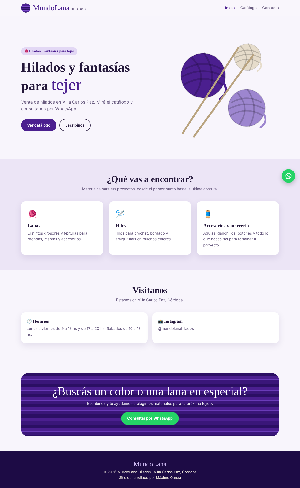

# MundoLana Hilados – Sitio web

Sitio web para **MundoLana Hilados**, una tienda de hilados de Villa Carlos Paz, Córdoba. Es un proyecto de portafolio de Máximo García.

## El problema que resuelve

La tienda necesitaba una web rápida y adaptada al celular. Ahí los clientes pueden ver el catálogo de lanas con sus colores, conocer los horarios y la ubicación, y hacer consultas o pedidos directamente por WhatsApp, sin depender solo de las redes sociales.

## Pantallas

- **Inicio (`index.html`):** presentación de la tienda, categorías de productos, datos de contacto y botón de WhatsApp.
- **Catálogo (`catalogo.html`):** productos filtrables por categoría, selector de colores y consulta por WhatsApp de cada producto.

## Tecnologías

- HTML5
- CSS3 (Flexbox, Grid, diseño responsive)
- JavaScript (sin librerías)

## Cómo editar los datos

Todos los datos de la tienda y del catálogo están en `js/config.js`:

- `TIENDA`: dirección, horarios, número de WhatsApp, Instagram y link de Google Maps. Si un dato queda vacío, esa parte no se muestra en la web.
- `PRODUCTOS`: lista de productos con nombre, categoría, descripción y colores.

## Cómo verla

Abrí `index.html` en el navegador. No hace falta instalar nada.

## Cómo publicarla (GitHub Pages)

Se hace una sola vez:

1. Entrá al repositorio en GitHub y andá a **Settings → Pages**.
2. En **Source** elegí **Deploy from a branch**.
3. En **Branch** elegí `main` y la carpeta `/ (root)`, y tocá **Save**.
4. Esperá un par de minutos. La web queda en `https://maximogarcia310-dot.github.io/Mundo-lana/`.

Después de eso, cada cambio que llega a `main` se publica solo.

## Capturas

